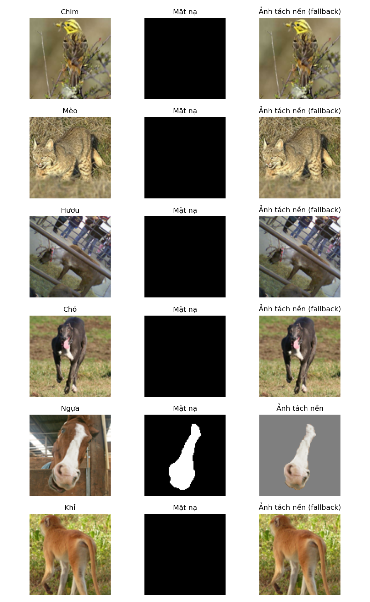
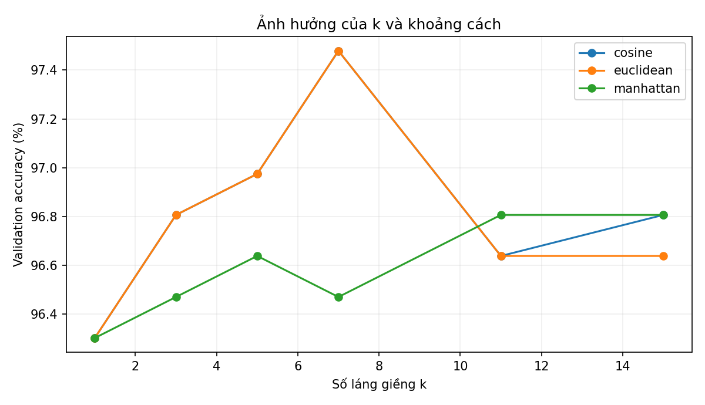
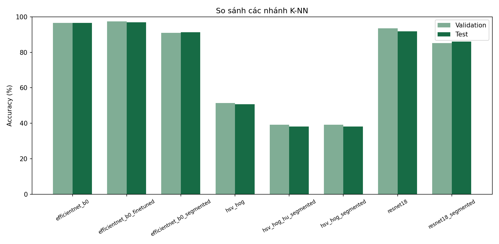
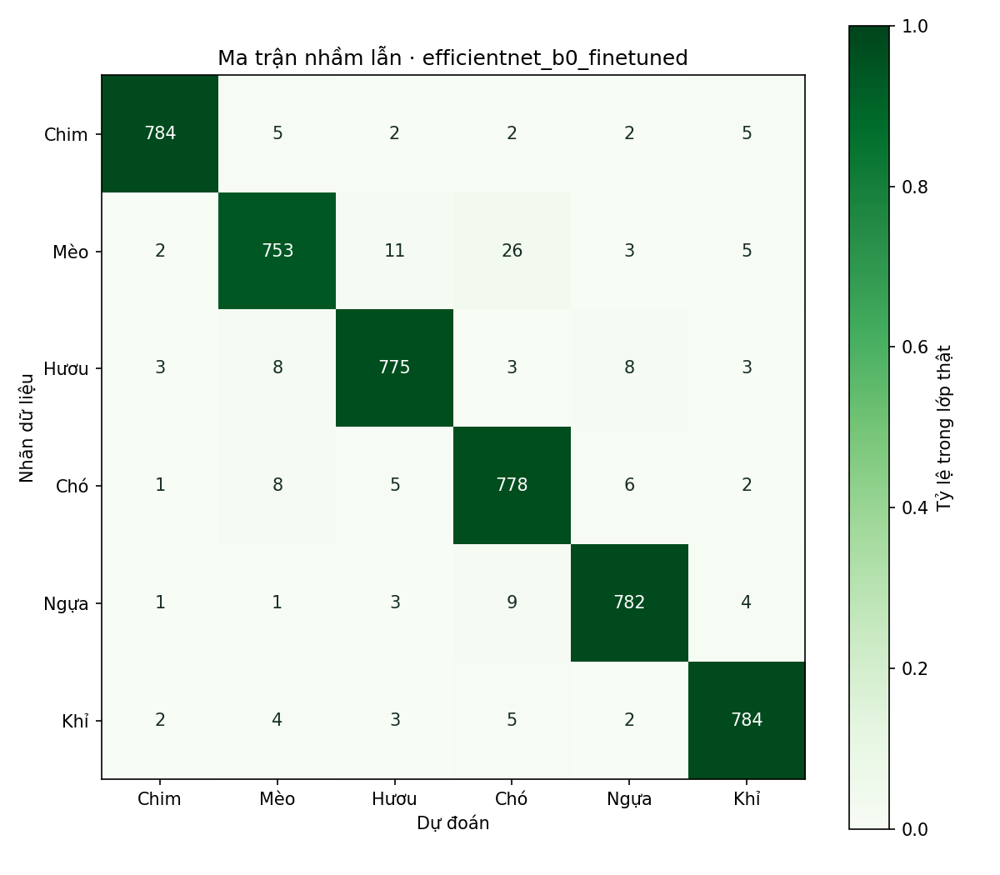
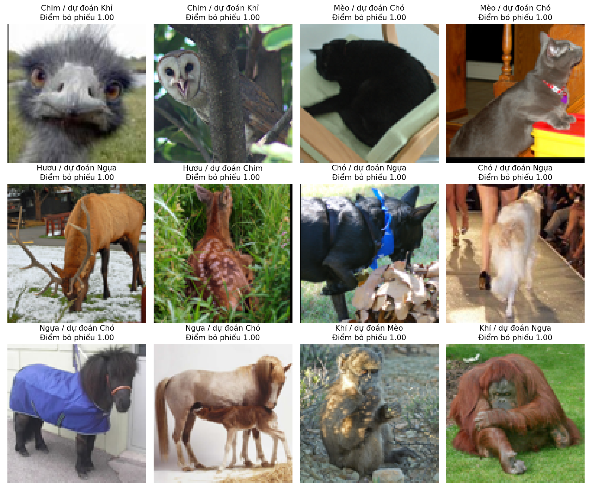
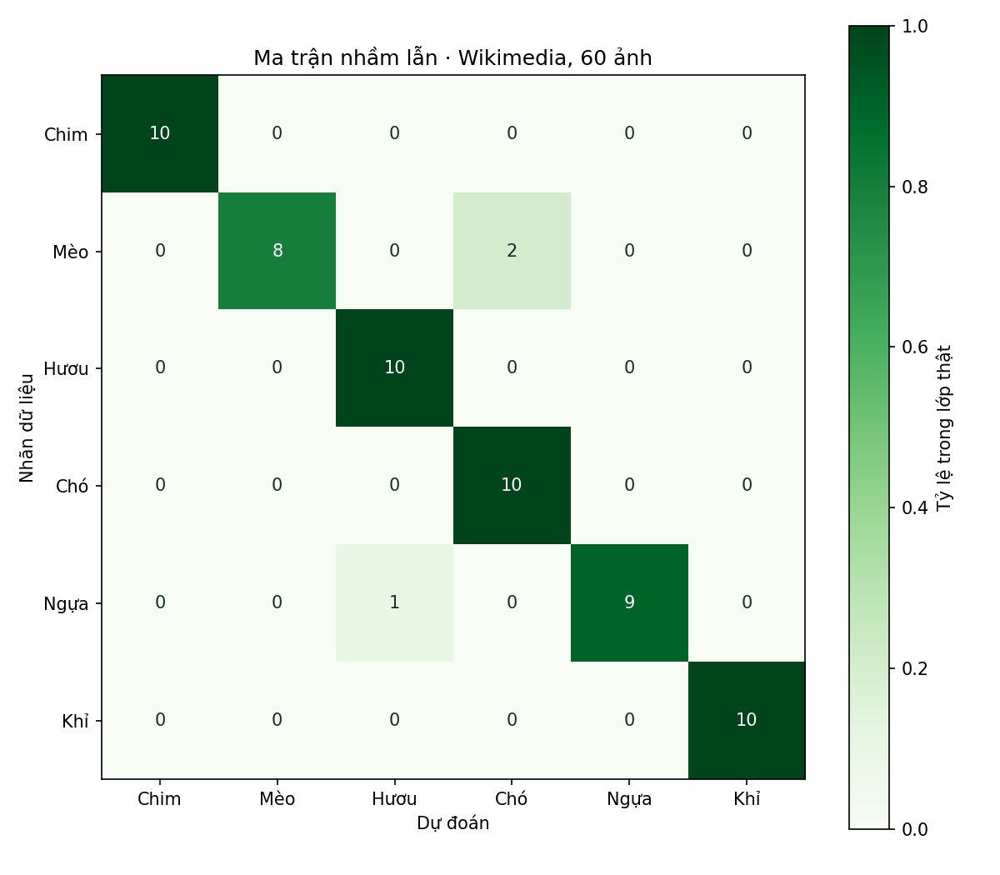

# Phân loại ảnh động vật bằng K-NN kết hợp đặc trưng màu sắc, hình dạng và học sâu

Báo cáo thực nghiệm · 18/11/2026 · Python, OpenCV, scikit-learn và PyTorch · sáu nhóm động vật STL-10

## 1. Kết quả chính

Cấu hình được chọn bằng validation là efficientnet_b0_finetuned, PCA=128, k=7, khoảng cách euclidean, bỏ phiếu distance. Trên 4,800 ảnh test, accuracy đạt 97.00% và macro-F1 đạt 0.9700. Khoảng tin cậy 95% xấp xỉ của accuracy là 96.52%–97.48% theo giả định các mẫu độc lập.

Mục tiêu accuracy và macro-F1 từ 0,90 đã đạt trong thiết lập đánh giá này.

Bộ ngoài gồm 60 ảnh Wikimedia có accuracy 95.00%, macro-F1 0.9496. Thời gian suy luận sau warm-up có trung vị 63.9 ms và phân vị 95 là 78.7 ms trên máy triển khai, không gồm khởi tạo mô hình và giải mã tệp ảnh. Đây là kiểm tra bổ sung nhỏ, có thiên lệch tuyển chọn.

## 2. Bài toán và tài liệu liên quan

Đầu vào là một ảnh có động vật nổi bật. Đầu ra thuộc một trong sáu nhóm: chim, mèo, hươu, chó, ngựa, khỉ. Đây là nhóm nhãn của bộ dữ liệu, không phải hệ phân loại loài sinh học chi tiết. K-NN là bộ phân loại cuối trong tất cả các nhánh; CNN chỉ tạo vector biểu diễn.

| Dự án | Ý nghĩa tham khảo | Nguồn |
| --- | --- | --- |
| Animal Image Classification | So sánh histogram, kết cấu và VGG16 với K-NN/SVM. | https://github.com/elfchildRichter/Animal_Image_Classification_Unsupervised |
| Coarse-to-Fine Image Classification | HOG, màu sắc và embedding ResNet18 cho nhóm động vật. | https://github.com/paigenewin/coarse-to-fine-image-classification |
| ResNet18 STL-10 Transfer Learning | Fine-tune, phát hiện quá khớp và phân tích từng lớp. | https://github.com/reluv17/resnet18-stl10-transfer-learning |

Các kho tham khảo giúp định hướng phương pháp. Báo cáo chỉ sử dụng số liệu do dự án này chạy được; không sao chép kết quả công bố của các kho trên.

## 3. Dữ liệu, làm sạch và giao thức

STL-10 cung cấp ảnh RGB 96 × 96. Dùng 3.000 ảnh có nhãn thuộc sáu nhóm trong train gốc và 4.800 ảnh thuộc sáu nhóm trong test gốc. Chia 80/20 train/validation có phân tầng theo lớp, seed 42. Bốn tệp nhị phân tải trực tiếp từ Stanford khớp MD5 trong Torchvision; không sử dụng tập 100.000 ảnh không nhãn.

Phát hiện ứng viên gần trùng bằng perceptual hash DCT 63 bit, ngưỡng Hamming không quá 5. Kiểm tra trực quan xác nhận 21 quan hệ gần trùng, tương ứng 20 ảnh cần loại: 15 train và 5 validation. Giữ ưu tiên test rồi validation rồi train. Những ảnh này là cùng bức ảnh có thay đổi nén/kích thước. Sau làm sạch, kiểm tra chéo không còn ứng viên trong ngưỡng đã chọn. Kết quả kiểm tra không phải bảo đảm rằng mọi kiểu trùng ngữ nghĩa đã được phát hiện.

| Tập dữ liệu | Chim | Mèo | Hươu | Chó | Ngựa | Khỉ |
| --- | --- | --- | --- | --- | --- | --- |
| train | 399 | 398 | 396 | 398 | 400 | 394 |
| val | 100 | 100 | 99 | 98 | 98 | 100 |
| test | 800 | 800 | 800 | 800 | 800 | 800 |
| excluded_near_duplicate | 1 | 2 | 5 | 4 | 2 | 6 |

Danh sách ảnh, SHA-256, nhãn, tập dữ liệu và quyết định loại ảnh được lưu để tái lập. Không có mẫu validation/test trong tập tham chiếu K-NN. Không có trùng ảnh chính xác theo SHA-256 giữa các tập ban đầu.

STL-10 lấy ảnh từ ImageNet, trong khi ResNet18 và EfficientNet-B0 sử dụng trọng số ImageNet-1K. Vì vậy, đây là đánh giá transfer learning trên tập con sáu lớp. Không so sánh trực tiếp với giao thức STL-10 10-fold chính thức hoặc mô hình chỉ học từ STL-10. Nghiên cứu chưa kiểm chứng việc trùng ảnh với toàn bộ dữ liệu tiền huấn luyện ImageNet.

## 4. Tiền xử lý và trích đặc trưng

Ảnh được sửa hướng EXIF, chuyển RGB, ghép nền trắng cho ảnh có alpha và đưa về 96 × 96. Nhánh CNN tiếp tục dùng phép biến đổi suy luận đi kèm trọng số Torchvision. Tất cả mẫu train, validation, test và ảnh người dùng đi qua cùng quy trình.

| Đặc trưng | Thiết lập | Số chiều |
| --- | --- | --- |
| HSV | Histogram 8 × 8 × 8, chuẩn hóa tổng bằng 1 | 512 |
| HOG | 9 hướng, cell 8 × 8, block 2 × 2, L2-Hys | 4.356 |
| Hu moments | 7 moments sau biến đổi log, từ mặt nạ | 7 |
| ResNet18 | Vector sau pooling, bỏ lớp fully connected | 512 |
| EfficientNet-B0 | Vector sau pooling, bỏ classifier | 1.280 |

GrabCut khởi tạo hình chữ nhật (3,3,90,90), chạy 5 vòng; mở và đóng hình thái với kernel 3 × 3. Nếu tỷ lệ foreground ngoài [0,05; 0,95] hoặc OpenCV báo lỗi, quay về ảnh gốc và ghi nhận fallback. Màu nền sau tách đối tượng là RGB (127,127,127). Hu moments được đặt 0 khi fallback. Không chỉnh mask theo nhãn hoặc bằng tay cho từng ảnh test.

Trong 7,800 ảnh đã tiền xử lý, GrabCut fallback 3,617 lần. Không có mặt nạ ground truth cho tập nghiên cứu nên không báo cáo IoU; ảnh hưởng của phân đoạn được đo qua phân loại với cùng bộ đặc trưng.

## 5. Khảo sát K-NN và fine-tune

K-NN được khảo sát với k ∈ {1,3,5,7,11,15}, khoảng cách Euclidean/Manhattan/cosine, bỏ phiếu uniform/distance và PCA không dùng/128/256 chiều: 108 cấu hình cho mỗi bộ đặc trưng. Scaler của nhánh thủ công và PCA chỉ fit train. Chuẩn hóa L2 được áp dụng trước K-NN. Các khoảng cách và láng giềng được tái sử dụng trong khảo sát để giảm tính toán, còn mô hình bàn giao dùng KNeighborsClassifier của scikit-learn.

Chọn cấu hình theo validation accuracy, rồi macro-F1, rồi thời gian tìm láng giềng khi hòa điểm. Chỉ tính chỉ số phân loại trên test sau khi đã lưu lựa chọn cuối và dấu vết SHA-256. Kiểm tra dữ liệu và tiền xử lý ảnh không học từ nhãn test. Các lệnh tune, fine-tune và select từ chối thay đổi nghiên cứu sau khi đánh giá test.

Backbone được fine-tune là efficientnet_b0. Huấn luyện đầu tạm 5 epoch với AdamW lr=0,001; sau đó mở khối cuối tối đa 10 epoch, lr=0,0001 cho cả đầu và khối cuối, weight decay=0,0001. Batch 16, mixed precision trên GPU. Dừng sớm khi validation loss không cải thiện trong 3 epoch. Các khối đóng băng giữ chế độ eval để thống kê BatchNorm không trôi. Đã chạy tổng cộng 13 epoch; checkpoint có validation loss thấp nhất được giữ, bỏ đầu phân loại rồi trích lại vector cho K-NN.

## 6. Kết quả so sánh

| Đặc trưng | Validation accuracy | Test accuracy | Test macro-F1 | Được chọn bằng validation |
| --- | --- | --- | --- | --- |
| efficientnet_b0 | 96.64% | 96.62% | 0.9663 | False |
| efficientnet_b0_finetuned | 97.48% | 97.00% | 0.9700 | True |
| efficientnet_b0_segmented | 90.92% | 91.27% | 0.9129 | False |
| hsv_hog | 51.43% | 50.71% | 0.4933 | False |
| hsv_hog_hu_segmented | 39.16% | 38.21% | 0.3715 | False |
| hsv_hog_segmented | 39.16% | 38.19% | 0.3712 | False |
| resnet18 | 93.61% | 91.92% | 0.9192 | False |
| resnet18_segmented | 85.21% | 86.06% | 0.8608 | False |

Mỗi nhánh trong bảng đã chọn tham số bằng validation trước khi đánh giá test. Điểm test của các nhánh là thông tin mô tả sau khóa nghiên cứu, không được dùng để đổi mô hình đã chọn.

So với HSV+HOG trên ảnh gốc, mô hình được chọn có chênh lệch test accuracy +46.29 điểm phần trăm. Khác biệt này phản ánh cả biểu diễn đặc trưng và cấu hình K-NN được chọn tương ứng, không phải kiểm định nhân quả độc lập cho từng thành phần.

Với cùng HSV+HOG, tách nền làm thay đổi test accuracy -12.52 điểm phần trăm. Tác dụng phân đoạn không được giả định trước là luôn có lợi; kết quả phụ thuộc việc giữ đúng đối tượng và mất hay giữ thông tin ngữ cảnh.

## 7. Phân tích từng lớp và lỗi

| Nhóm | Precision | Recall | F1 | Số ảnh |
| --- | --- | --- | --- | --- |
| Chim | 0.9887 | 0.9800 | 0.9843 | 800 |
| Mèo | 0.9666 | 0.9413 | 0.9538 | 800 |
| Hươu | 0.9700 | 0.9688 | 0.9694 | 800 |
| Chó | 0.9453 | 0.9725 | 0.9587 | 800 |
| Ngựa | 0.9738 | 0.9775 | 0.9757 | 800 |
| Khỉ | 0.9763 | 0.9800 | 0.9782 | 800 |

Chó bị dự đoán thành mèo 8 lần, mèo thành chó 26 lần. Hươu thành ngựa 8 lần, ngựa thành hươu 3 lần. Các lỗi cần xem theo dáng, tư thế, tỉ lệ đối tượng và nền thay vì chỉ dựa vào nhãn tổng hợp.

Các phép đo so sánh dự đoán với nhãn công bố của bộ dữ liệu. Quan sát trực quan một số ảnh sai có điểm cao cho thấy dấu hiệu nhiễu nhãn hoặc động vật ngoài sáu nhóm. Đã đối chiếu chỉ số ảnh, pixel và nhãn với tệp nhị phân gốc để loại trừ lỗi ghép ảnh/nhãn của chương trình. Không sửa nhãn test sau khi xem kết quả; các trường hợp này được giữ lại và nêu như một giới hạn của đánh giá.

## 8. Đánh giá ngoài STL-10

Bộ cố định gồm 60 ảnh Wikimedia Commons, 10 ảnh mỗi nhóm, thu thập trước khi xem kết quả mô hình. Kiểm tra trực quan loại ảnh trứng, bộ xương và áo lông không phù hợp. Mỗi ảnh giữ tên tệp, trang nguồn, tác giả, giấy phép, ngày nguồn cung cấp và SHA-256. Không phát hiện ứng viên gần trùng với STL-10 ở ngưỡng perceptual hash đã dùng.

| Nhóm | Số ảnh | Tỷ lệ dự đoán đúng | F1 |
| --- | --- | --- | --- |
| Chim | 10 | 100.00% | 1.0000 |
| Mèo | 10 | 80.00% | 0.8889 |
| Hươu | 10 | 100.00% | 0.9524 |
| Chó | 10 | 100.00% | 0.9091 |
| Ngựa | 10 | 90.00% | 0.9474 |
| Khỉ | 10 | 100.00% | 1.0000 |

Giới hạn: cỡ mẫu nhỏ, nhiều ảnh chụp rõ đối tượng và truy vấn thiên về một số giống/loài. Một số ảnh có tuổi đời trước ImageNet và có thể xuất hiện trong nguồn tiền huấn luyện; nghiên cứu không tuyên bố bộ này hoàn toàn chưa từng được backbone nhìn thấy. Không suy rộng accuracy này cho mọi ảnh Internet.

## 9. Demo và kiểm chứng phần mềm

Ứng dụng Windows viết bằng Tkinter/ttk, mở từ mã nguồn qua run-desktop.bat. Cửa sổ nhận JPG/PNG qua hộp chọn tệp Windows, hiển thị nhãn, điểm bỏ phiếu, thời gian, ảnh tiền xử lý và năm láng giềng chỉ từ train. Nạp mô hình và suy luận chạy ở luồng nền, cập nhật widget ở luồng chính. Bộ mô hình gồm encoder, chuẩn hóa/PCA, K-NN, nhãn và ảnh tham chiếu nên không cần trình duyệt, web server hoặc Internet khi phân loại.

| Kiểm tra | Kết quả |
| --- | --- |
| Checksum dữ liệu gốc | Đạt |
| Số ảnh tham chiếu, chỉ từ train | 2385 |
| Không trùng SHA-256 giữa train và holdout | Đạt |
| Ứng viên gần trùng còn lại sau làm sạch | 0 |
| Vector cache và suy luận trực tiếp tương thích | Đạt |
| Điểm bỏ phiếu cache và trực tiếp nhất quán | Đạt |
| Sai khác L2 tương đối lớn nhất giữa các batch | 0.0638% |
| Tái lập đúng chỉ số validation của mô hình đã lưu | Đạt |
| Validation accuracy tái lập | 97.48% |
| Số mẫu cùng dự đoán trên CPU và GPU | 3 |
| Giữ nguyên dự đoán sau lưu/nạp mô hình | Đạt |
| Kiểm thử tự động | 15 passed in 6.87s |
| Đặc trưng được chọn | efficientnet_b0_finetuned |
| Kết quả ảnh demo | Mèo |

Kiểm tra giao diện Windows: Sáu ảnh mẫu chạy qua bộ điều khiển Tkinter ẩn, nhãn/điểm bỏ phiếu/ID năm láng giềng khớp backend. Luồng sự kiện vẫn phản hồi trong khi nạp và suy luận. 15 kiểm thử mã thành công, gồm ảnh hỏng, ảnh xám/alpha, lỗi mô hình và đóng trong khi xử lý. Chưa hoàn tất kiểm tra trực quan cửa sổ kết quả vì người dùng đã dừng công cụ điều khiển màn hình.

## 10. Giới hạn và hướng phát triển

- Chỉ chọn trong sáu nhóm đã biết, chưa phát hiện lớp lạ hoặc ảnh không chứa động vật.
- Ảnh nhiều đối tượng, che khuất, ánh sáng khó và thay đổi miền dữ liệu có thể làm giảm độ chính xác.
- Phân đoạn GrabCut có thể làm mất bộ phận quan trọng; chưa có đo IoU bằng ground truth.
- Một số ảnh minh họa có dấu hiệu nhiễu nhãn bộ dữ liệu; chỉ số test vẫn dùng nhãn công bố, chưa hiệu đính.
- Chưa loại hết khả năng trùng nguồn với ImageNet tiền huấn luyện, vì vậy phải giữ mô tả transfer learning.
- Thí nghiệm fine-tune dùng một seed chính; chưa đo độ biến thiên qua nhiều lần huấn luyện độc lập.
- Bước tiếp theo: bộ ảnh ngoài lớn và đa dạng hơn, kiểm chứng nguồn tiền huấn luyện, bổ sung nhận biết lớp lạ và nhiều seed.

## 11. Tái lập và nguồn

README mô tả môi trường, từng lệnh CLI và cách tái lập trong thư mục mới. requirements.lock.txt khóa phiên bản. data/curation ghi quyết định làm sạch; results/tuning chứa toàn bộ grid; models/selection.json và results/test_access_receipt.json ghi lựa chọn trước test. Agent Reach 1.6.1 được cài trong môi trường dự án và đã kiểm tra tìm kiếm/đọc web.

- STL-10, Stanford: https://cs.stanford.edu/~acoates/stl10/
- Torchvision STL-10 source: https://github.com/pytorch/vision/blob/v0.24.1/torchvision/datasets/stl10.py
- PyTorch transfer learning: https://docs.pytorch.org/tutorials/beginner/transfer_learning_tutorial.html
- KNeighborsClassifier: https://scikit-learn.org/stable/modules/generated/sklearn.neighbors.KNeighborsClassifier.html
- OpenCV GrabCut: https://docs.opencv.org/4.x/d8/d83/tutorial_py_grabcut.html
- Agent Reach: https://github.com/Panniantong/Agent-Reach
- Tkinter, Python 3.10: https://docs.python.org/3.10/library/tkinter.html
- HOG/SIFT/ORB và K-NN cho động vật: https://github.com/RANA-ATI/Animals-Classification-using-Feature-Extractors
- Đặc trưng HSV/VGG16 và K-NN: https://github.com/elfchildRichter/Animal_Image_Classification_Unsupervised
- GUI Tkinter phân loại động vật: https://github.com/AlvaroVasquezAI/Animal_Image_Classification
- Animal classifier GUI: https://github.com/cyproto/image_classification-animals-with-gui

Nguồn và giấy phép từng ảnh ngoài nằm trong data/external/manifest.csv và reports/EXTERNAL_ATTRIBUTION.html. Mã dự án có giấy phép MIT; dữ liệu và trọng số giữ điều khoản nguồn gốc.

Các kho cùng hướng được đối chiếu về nhánh đặc trưng và luồng GUI, không dùng số liệu công bố của họ làm kết quả. Nội dung đã đọc và quyết định áp dụng được ghi trong reports/DU_AN_THAM_KHAO.md; mã cửa sổ của đồ án được viết riêng.
